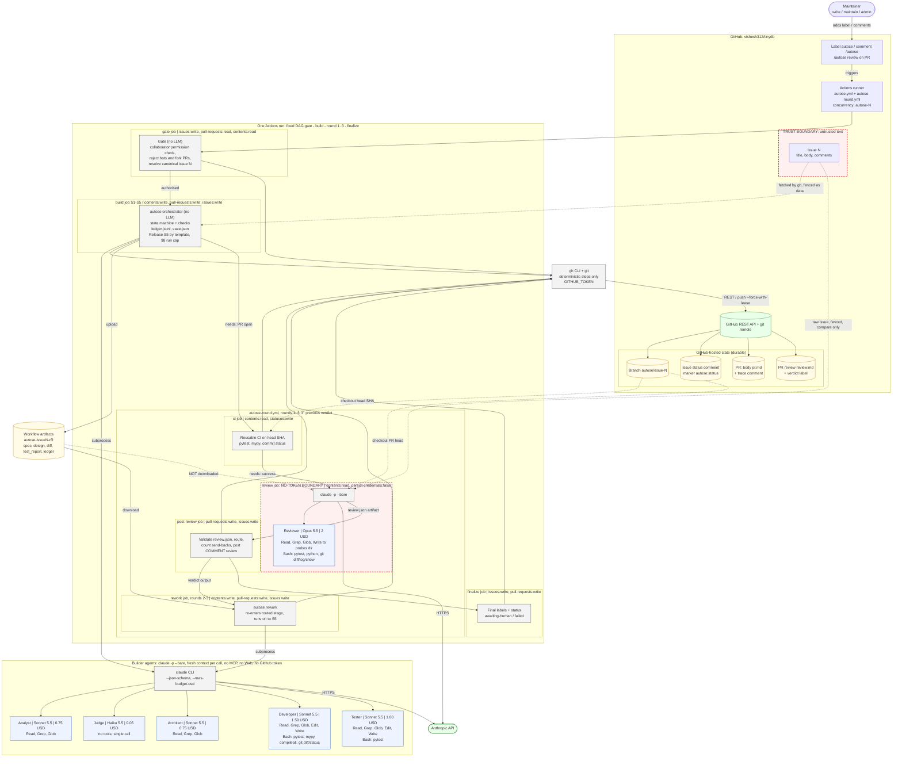
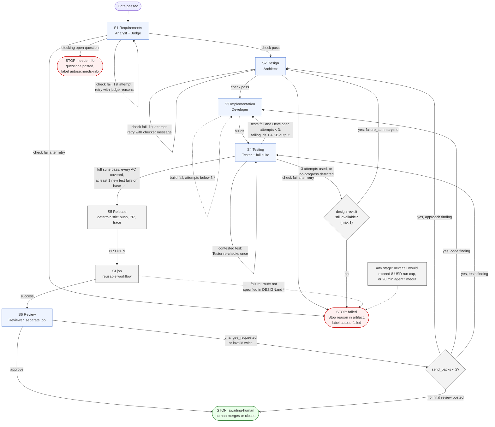

# Component view

Source of truth: [`../DESIGN.md`](../DESIGN.md) (sections 2, 3, 5, 6, 7, 10). Rendered copies for the report: `component-view.svg` / `.png`, `state-machine.svg` / `.png` (sources: `*.mmd` in this folder, rendered with `@mermaid-js/mermaid-cli@11.4.2`).

## 1. Components, tools and who calls whom

### Legend

| Notation | Meaning |
|---|---|
| Large boxes with a header (`gate job`, `build job`, ...) | One GitHub Actions job (its own runner). The header lists the job's `GITHUB_TOKEN` permissions. |
| `autose-round.yml` box | Reusable workflow called up to 3 times (rounds 1..3), each gated by `if:` on the previous round's `verdict`. `rework` only exists in rounds 2 and 3. |
| Blue rectangles | LLM agents (`claude -p --bare`), annotated with role, model and per-call `--max-budget-usd` cap, and the `--tools` / Bash allowlist. |
| Grey rectangles | Deterministic code (no LLM): gate, orchestrator, CI, post-review, finalize, `gh`/`git`, the `claude` CLI process. |
| Cylinders | Data stores (workflow artifacts, branch, status comment, PR body/trace comment, PR review). |
| Green | External services (Anthropic API, GitHub REST API / git remote). |
| Red dashed box | Trust boundary: (a) untrusted issue text, (b) the review job, which has no token in the agent environment, no write permission and no build artifacts. |
| Solid arrow | Call / control (subprocess, HTTP, `needs:`). |
| Dotted arrow | Data flow only (text that is read, a checkout). |
| Dotted arrow ending in `x` | Deliberately absent flow (the review job never downloads the build artifacts). |

Key properties the diagram shows:

- **Only deterministic code talks to GitHub.** Every GitHub call goes `job step -> gh CLI / git (GITHUB_TOKEN) -> GitHub REST / remote`. No agent has an edge to GitHub; agent processes do not get `GH_TOKEN`/`GITHUB_TOKEN`, `actions/checkout` uses `persist-credentials: false`, and no agent has MCP, WebFetch or WebSearch.
- **Only the `claude` CLI talks to the model provider.** The path is `orchestrator -> claude CLI (subprocess) -> Anthropic API`. The Judge also goes through this path, as a single call with no tools.
- **Untrusted text** (issue title, body, comments) enters in two places only, both read-only and fenced as data: the Analyst (through the orchestrator) and the Reviewer (for comparison only). Write-capable agents (Developer, Tester) see only derived artifacts.
- **The review job is isolated.** It runs on a fresh runner with `contents: read` only, gets the PR head checkout, the raw issue and its own earlier findings, and never downloads `autose-issueN-rR`.

### Component table

| Component | Responsibility | Tools / permissions | Talks to |
|---|---|---|---|
| Maintainer | Triggers a run (label `autose`, `/autose`, `/autose review`); makes the final merge/close decision | write/maintain/admin on the fork | GitHub UI |
| GitHub issue / PR / labels / comments | Trigger events; untrusted input; human-visible state | — | Actions runner (events) |
| Actions runner (`autose.yml`, `autose-round.yml`) | Runs the fixed job DAG gate, build, round 1..3, finalize; `concurrency: autose-<N>`, `cancel-in-progress: false` | timeouts: build 60 min, review 30 min, CI 15 min | All jobs |
| gate job | Authorises the sender (collaborators API, not only `author_association`), ignores bots, rejects comments on PRs from forks, resolves the canonical issue number, creates the status comment | `issues: write`, `pull-requests: read`, `contents: read` | `gh` -> GitHub REST |
| build job: `autose` orchestrator | Deterministic state machine for S1-S5; runs every check; writes `ledger.jsonl` and `state.json`; enforces the $8 run cap; performs S5 Release from templates; uploads workflow artifacts | `contents: write`, `pull-requests: write`, `issues: write` | `claude` CLI (subprocess), `gh`/`git`, workflow artifacts |
| rework job (rounds 2-3) | Same orchestrator, re-entering at the stage the reviewer routed to and running on to S5 | `contents: write`, `pull-requests: write`, `issues: write` | `claude` CLI, `gh`/`git`, workflow artifacts (download) |
| ci job | Reusable CI on the head SHA (because pushes made with `GITHUB_TOKEN` do not trigger workflows); posts a commit status | `contents: read`, `statuses: write` | `gh` -> commit status; branch checkout |
| review job | Runs the Reviewer on a fresh runner; uploads `review.json` | `contents: read` (checkout only); no token in agent env; no artifacts downloaded | `claude` CLI -> Anthropic API |
| post-review job | Validates `review.json` (re-asks once if invalid), computes the route, counts send-backs, posts a `COMMENT` review with the verdict in the header, applies the verdict label, outputs `verdict` | `pull-requests: write`, `issues: write` | `gh` -> GitHub REST |
| finalize job | Applies the final label (`autose:awaiting-human` / `autose:failed`) and writes the final status comment | `issues: write`, `pull-requests: write` | `gh` -> GitHub REST |
| `claude` CLI | Headless harness: `claude -p --bare --no-session-persistence --model <m> --tools ... --allowedTools ... --max-budget-usd <cap> --output-format json --json-schema <schema>`; 20 min subprocess timeout | `ANTHROPIC_API_KEY` only | Anthropic API |
| Analyst | S1: issue -> `spec.json` (A1 `requirements-spec` skill + issue adapter) | Sonnet 5.5, medium effort, $0.75; Read, Grep, Glob (read-only) | orchestrator (via structured output) |
| Judge | S1: rates each AC as testable or not | Haiku 5.5, low effort, $0.05; no tools, single call | orchestrator |
| Architect | S2: `spec.md` + `ARCHITECTURE.md` -> `design.json` | Sonnet 5.5, medium effort, $0.75; Read, Grep, Glob | orchestrator |
| Developer | S3: edits `tinydb/**` following the design; writes `dev_notes.json` | Sonnet 5.5, high effort, $1.50; Read, Grep, Glob, Edit, Write, Bash(`python -m pytest*`, `python -m mypy*`, `python -m compileall*`, `git diff*`, `git status*`) | orchestrator (working tree) |
| Tester | S4: writes `tests/test_autose_issue_<N>.py` and `test_map.json` from the ACs and the public API section | Sonnet 5.5, medium effort, $1.00; Read, Grep, Glob, Edit, Write, Bash(`python -m pytest*`) | orchestrator (working tree) |
| Reviewer | S6: adversarial review from the issue + diff + repo at the PR head -> `review.json` | Opus 5.5, high effort, $2.00; Read, Grep, Glob, Write (only `$RUNNER_TEMP/review-probes/`), Bash(`python -m pytest*`, `python*`, `git diff*`, `git log*`, `git show*`) | review job (structured output) |
| `gh` CLI + `git` | The only GitHub client; used by deterministic steps only | job's `GITHUB_TOKEN` | GitHub REST API, git remote |
| Anthropic API | Model inference | provider-side hard spend limit | — |
| Workflow artifacts `autose-issue<N>-r<round>` | State between jobs in one run (spec, design, diff, test report, ledger, state) | upload/download-artifact | build/rework (up), rework (down); review job: not downloaded |
| Branch `autose/issue-<N>` | The code under review; force-pushed with lease | — | ci, review (checkout) |
| Issue status comment (`<!-- autose:status -->`) | Sticky, edited-in-place stage table with links | — | humans |
| PR body (`pr.md`) + trace comment | PR description from template; spec/design/test report in collapsed sections | — | humans (not the Reviewer) |
| PR review (`review.md`) + label | Reviewer verdict as `COMMENT` review; `autose:review-approved` / `autose:review-changes-requested` | — | humans |

## 2. In-job state machine (orchestrator)

`next_stage = f(stage, check_result, counters)`; every transition is appended to `ledger.jsonl`. S1-S5 run inside the build job (or a rework job); CI and S6 run in the round jobs, and the route chosen by post-review re-enters the state machine in the next round's rework job.

Caps used (DESIGN.md section 10): spec retry 1 (2 attempts), design retry 1 (2 attempts), 3 Developer attempts per design, 1 design revisit, 2 review send-backs, $8 per run, 20 min per agent call.

Edges marked `*` are not stated explicitly in DESIGN.md and are drawn as the most literal reading:

- S3 build failure: DESIGN.md gives the S3 check but no explicit route; drawn as consuming a Developer attempt.
- CI failure: DESIGN.md defines "CI concludes success" as the S5 check but gives no route for a CI failure; drawn as a stop.
- No-progress detection "escalates straight away"; drawn as jumping to the same escalation point as "3 attempts used".
