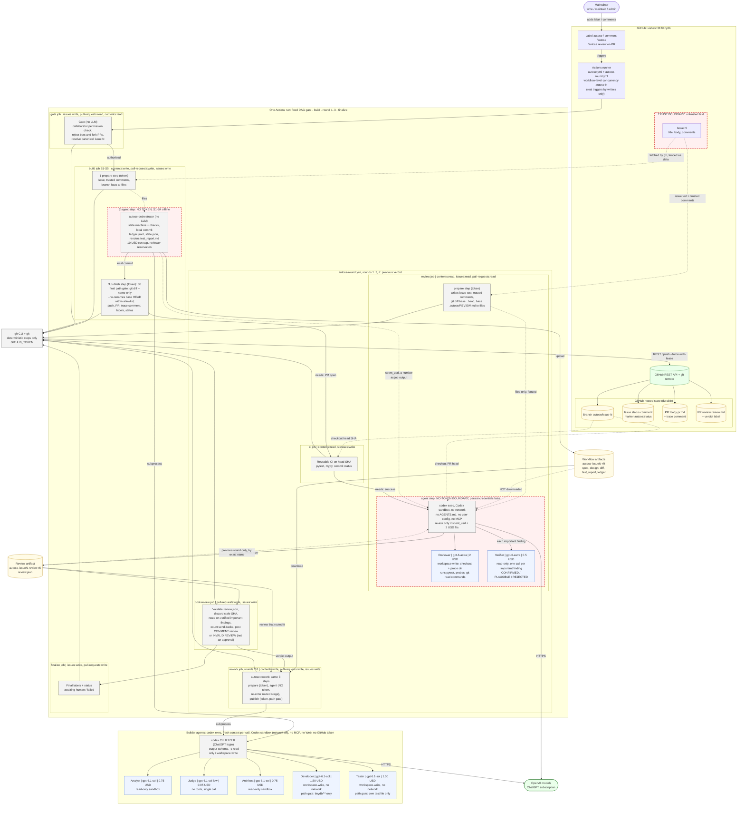
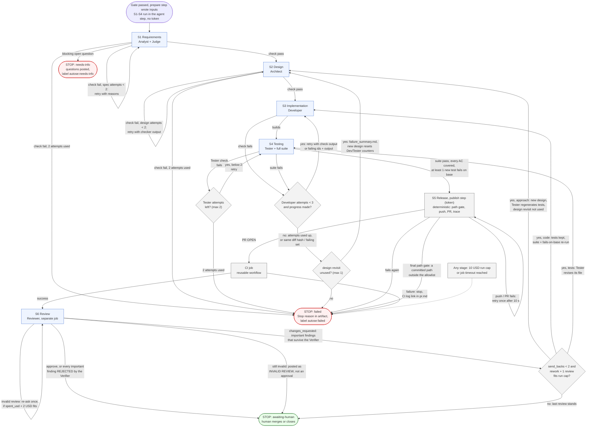

# Component view

Source of truth: [`../DESIGN.md`](../DESIGN.md) (sections 2, 2.1, 3, 5, 6, 7, 10) and the ADRs in [`../decisions/`](../decisions/). Rendered copies for the report: `component-view.svg` / `.png`, `state-machine.svg` / `.png` (sources: `*.mmd` in this folder, rendered with `@mermaid-js/mermaid-cli@11.4.2`).

## 1. Components, tools and who calls whom

### Legend

| Notation | Meaning |
|---|---|
| Large boxes with a header (`gate job`, `build job`, ...) | One GitHub Actions job (its own runner). The header lists the job's `GITHUB_TOKEN` permissions (the workflow level grants `permissions: {}`). Inside build and review, numbered/nested boxes are **steps**: only the prepare and publish steps hold the token. |
| `autose-round.yml` box | Reusable workflow called up to 3 times (rounds 1..3), each gated by `if:` on the previous round's `verdict`. `rework` only exists in rounds 2 and 3. |
| Blue rectangles | LLM agents (`codex exec`, ADR-014), annotated with role, model, per-call notional cap (list-price-equivalent $, checked by the orchestrator) and Codex sandbox mode. |
| Grey rectangles | Deterministic code (no LLM): gate, orchestrator, CI, post-review, finalize, `gh`/`git`, the `codex` CLI process. |
| Cylinders | Data stores (workflow artifacts, branch, status comment, PR body/trace comment, PR review). |
| Green | External services (OpenAI models through the ChatGPT subscription, GitHub REST API / git remote). |
| Red dashed box | Trust boundary: (a) untrusted issue text, (b) the build/rework **agent step** (no token; S1-S4 run offline and end in a local commit), (c) the review job's agent step, which has no token in its environment, no write permission and no build artifacts (only files written by the prepare step and its own previous `review.json`). |
| Solid arrow | Call / control (subprocess, HTTP, `needs:`). |
| Dotted arrow | Data flow only (text that is read, a checkout). |
| Dotted arrow ending in `x` | Deliberately absent flow (the review job never downloads the build artifacts `autose-issueN-rR`). |

Key properties the diagram shows:

- **No token next to agent-influenced code.** build and rework are split into three steps: *prepare* (token) writes the issue, trusted comments and branch facts to files; *agent* (no token) runs the orchestrator and S1-S4 offline, ending in a local commit; *publish* (token) runs the final path gate (`git diff --name-only --no-renames <base> HEAD` must be within the allowlist), then pushes with lease, opens/updates the PR, posts the trace comment, labels and status. Push credentials exist only in publish. The review job has the same prepare/agent shape.
- **Only deterministic code talks to GitHub.** Every GitHub call goes `prepare/publish/post/finalize step -> gh CLI / git (GITHUB_TOKEN) -> GitHub REST / remote`. No agent has an edge to GitHub; agent processes do not get `GH_TOKEN`/`GITHUB_TOKEN`, `actions/checkout` uses `persist-credentials: false`, every agent runs `codex exec --ignore-user-config --ignore-rules -c project_doc_max_bytes=0` in the Codex sandbox with network off, and no agent has MCP or web access.
- **Only the `codex` CLI talks to the model provider.** The path is `orchestrator -> codex CLI (subprocess) -> OpenAI (ChatGPT subscription)`. The Judge and the Verifier also go through this path. The ChatGPT login (`auth.json`) is written only in the tokenless agent steps and deleted afterwards. (With `AUTOSE_BACKEND_REVIEWER=agy`, used only for E1's cross-vendor arm, the Reviewer and Verifier go through the Antigravity CLI instead.)
- **Untrusted text** (issue title, body, comments) enters in two places only, both read-only and fenced as data: the Analyst (through files written by the build job's prepare step) and the Reviewer (through files written by the review job's prepare step, for comparison only). Write-capable agents (Developer, Tester) see only derived artifacts.
- **The review job is isolated.** It runs on a fresh runner with read-only permissions (`contents`, `issues`, `pull-requests`). A *prepare* step uses the token to write the issue text, trusted comments and `git diff base...head` to files; the *agent* step then runs with no token in its environment and reads only those files plus the PR head checkout. Optional maintainer review rules (`.autose/REVIEW.md`) are read from the **base** commit by the prepare step, never from the PR head (ADR-015). Each `important` finding of a valid review is then re-checked by a separate read-only Verifier call that sees only that finding, the issue, the diff and the code; rejected findings are shown but do not route. The only artifact it downloads is its own previous round's `review.json` (`autose-issueN-review-rK`, fetched by exact name); it never downloads `autose-issueN-rR`. It receives the run's spend so far as a plain number (`spent_usd`, a job output, not an artifact) and re-asks an invalid review only if `spent_usd` + one Reviewer cap still fits the run cap.

### Component table

| Component | Responsibility | Tools / permissions | Talks to |
|---|---|---|---|
| Maintainer | Triggers a run (label `autose`, `/autose`, `/autose review`); makes the final merge/close decision | write/maintain/admin on the fork | GitHub UI |
| GitHub issue / PR / labels / comments | Trigger events; untrusted input; human-visible state | — | Actions runner (events) |
| Actions runner (`autose.yml`, `autose-round.yml`) | Runs the fixed job DAG gate, build, round 1..3, finalize; workflow-level `concurrency: autose-<N>`, `cancel-in-progress: false`, applied only to real triggers (`autose` label, `/autose` comment by OWNER/MEMBER/COLLABORATOR); other events get a `github.run_id` group and exit in the gate. No job-level groups (dropped, ADR-010 revision note) | timeouts: build 60 min, review 45 min, CI 15 min | All jobs |
| gate job | Authorises the sender (collaborators API, not only `author_association`), ignores bots, rejects comments on PRs from forks, resolves the canonical issue number, creates the status comment | `issues: write`, `pull-requests: read`, `contents: read` | `gh` -> GitHub REST |
| build job: prepare step | Writes issue text, trusted comments and branch facts (incl. non-bot commits on the branch) to files | token (`issues`, `contents`) | `gh` -> GitHub REST |
| build job: agent step, `autose` orchestrator | Deterministic state machine for S1-S4, offline and with **no token**, ending in a local commit; runs every check; writes `ledger.jsonl` and `state.json`; renders `test_report.md` from pytest results, `test_map.json` and fails-on-base results; enforces the $10 notional run cap (a rework only starts if one Reviewer cap plus one Verifier cap still fits after it); git runs with hooks and fsmonitor disabled; check subprocesses get a scrubbed env; outputs `spent_usd` | no token in env; `CODEX_HOME` with the ChatGPT login | `codex` CLI (subprocess), local files, workflow artifacts |
| build job: publish step (S5) | Final path gate (`git diff --name-only --no-renames <base> HEAD` within the allowlist), force-push with lease, open/update PR from template, trace comment, labels, status; `gh --repo vishesh312/tinydb` always | `contents: write`, `pull-requests: write`, `issues: write`; push credentials configured only here | `gh`/`git` -> GitHub |
| rework job (rounds 2-3) | Same prepare / agent (no token) / publish split; downloads build-side state and the review that routed it; checks the reviewer reservation, re-enters at the routed stage and runs on to S5 | `contents: write`, `pull-requests: write`, `issues: write` | `codex` CLI, `gh`/`git`, workflow artifacts (download) |
| ci job | Reusable CI on the head SHA (because pushes made with `GITHUB_TOKEN` do not trigger workflows); posts a commit status | `contents: read`, `statuses: write` | `gh` -> commit status; branch checkout |
| review job | Prepare step (with token) writes issue text, trusted comments and `git diff` to files; agent step (no token) runs the Reviewer on the PR head checkout, then the Verifier once per `important` finding; uploads `review.json` as `autose-issue<N>-review-r<k>` | `contents: read`, `issues: read`, `pull-requests: read`; no token in the agent step's env; downloads only the previous round's review artifact | prepare: `gh` -> GitHub REST; agent: `codex` CLI -> OpenAI |
| post-review job | Validates `review.json`, discards a review whose SHA is no longer the PR head, computes the route from `important` findings that survived verification only (`pre_existing` and `nit` never route), counts send-backs, posts a `COMMENT` review with the verdict in the header (an invalid review is posted under "INVALID REVIEW (not an approval)"), applies the verdict label, outputs `verdict` | `pull-requests: write`, `issues: write` | `gh` -> GitHub REST |
| finalize job | Runs under `if: always()`; applies the final label (`autose:awaiting-human` / `autose:failed`) and writes the final status comment | `issues: write`, `pull-requests: write` | `gh` -> GitHub REST |
| `codex` CLI | Headless harness (pinned `@openai/codex@0.172.0`, ADR-014): `codex exec --ephemeral --ignore-user-config --ignore-rules --json -m <m> -s read-only\|workspace-write -c approval_policy=never -c sandbox_workspace_write.network_access=false -c project_doc_max_bytes=0 -c developer_instructions=<system prompt> --output-schema <schema> -o <file> -`; 20 min subprocess timeout. The legacy `claude -p --bare` runner (ADR-011) stays selectable with `AUTOSE_BACKEND=claude` | `CODEX_HOME/auth.json` (ChatGPT login) only | OpenAI |
| Analyst | S1: issue -> `spec.json` (A1 `requirements-spec` skill + issue adapter) | `gpt-6.1-sol`, medium effort, $0.75; read-only sandbox | orchestrator (via structured output) |
| Judge | S1: rates each AC as testable or not | `gpt-6.1-sol`, low effort, $0.05; no tools, single call | orchestrator |
| Architect | S2: `spec.md` + `ARCHITECTURE.md` -> `design.json` | `gpt-6.1-sol`, medium effort, $0.75; read-only sandbox | orchestrator |
| Developer | S3: edits `tinydb/**` following the design; writes `dev_notes.json` | `gpt-6.1-sol`, high effort, $1.50; workspace-write sandbox, no network (legacy `claude` backend: Bash limited to pytest, mypy, compileall, git diff/status); writes outside `tinydb/**` fail the path check | orchestrator (working tree) |
| Tester | S4: writes `tests/test_autose_issue_<N>.py` and `test_map.json` from the ACs and the public API section | `gpt-6.1-sol`, medium effort, $1.00; workspace-write sandbox, no network (legacy `claude` backend: Bash limited to pytest); any path other than its test file fails the check | orchestrator (working tree) |
| Reviewer | S6: adversarial review from the issue + diff + repo at the PR head -> `review.json` | `gpt-6-astra`, high effort, $2.00; workspace-write sandbox on the checkout plus `$RUNNER_TEMP/review-probes/`, no network (the job cannot push, so working-tree changes are discarded) | review job (structured output) |
| Verifier (ADR-015) | S6: re-checks one `important` finding in a fresh context -> `verify.json` (`CONFIRMED`/`PLAUSIBLE`/`REJECTED`) | `gpt-6-astra`, medium effort, $0.50; read-only sandbox; sees the issue, diff, code and that one finding only | review job (structured output) |
| `gh` CLI + `git` | The only GitHub client; used by deterministic steps only | job's `GITHUB_TOKEN` | GitHub REST API, git remote |
| OpenAI (ChatGPT subscription) | Model inference | subscription usage limits; run cap in notional $ | — |
| Workflow artifacts `autose-issue<N>-r<round>` | State between jobs in one run (spec, design, diff, test report, ledger, state) | upload/download-artifact | build/rework agent step (up), rework (down); review job: not downloaded |
| Review artifact `autose-issue<N>-review-r<k>` | `review.json` of round k | upload/download-artifact | review job (up; next round's review job down, by exact name), post-review and rework (down) |
| Branch `autose/issue-<N>` | The code under review; force-pushed with lease | — | ci, review (checkout) |
| Issue status comment (`<!-- autose:status -->`) | Sticky, edited-in-place stage table with links | — | humans |
| PR body (`pr.md`) + trace comment | PR description from template; spec/design/test report in collapsed sections | — | humans (not the Reviewer) |
| PR review (`review.md`) + label | Reviewer verdict as `COMMENT` review; `autose:review-approved` / `autose:review-changes-requested` | — | humans |

## 2. In-job state machine (orchestrator)

`next_stage = f(stage, check_result, counters)`; every transition is appended to `ledger.jsonl`. S1-S4 run in the no-token agent step of the build job (or a rework job), S5 in its publish step; CI and S6 run in the round jobs, and the route chosen by post-review re-enters the state machine in the next round's rework job.

Every edge follows the routing table in DESIGN.md section 2.1 ("every failed check has exactly one route"). Caps: 2 spec attempts, 2 design attempts, 3 Developer attempts and 2 Tester attempts per design, 1 in-build design revisit, 2 review send-backs, $10 per run, 20 min per agent call. Only `important` findings that survive the verification pass (ADR-015) route; an invalid review (still invalid after one re-ask) has no category and ends the run `awaiting-human`. A new design (from the revisit or from an `approach` send-back) resets the Developer and Tester counters; an `approach` send-back does not use the in-build design revisit. "No progress" means the same diff hash **or** the same failing test set as the previous attempt, and is treated as if the Developer attempts were exhausted. A send-back only starts if one Reviewer cap plus one Verifier cap ($2 + $0.50) still fits under the run cap after the rework (reservation, ADR-006, ADR-015); otherwise the last review stands. The invalid-review re-ask is not reserved: it runs only if `spent_usd` + $2 fits, and a review still invalid is posted under "INVALID REVIEW (not an approval)". The publish step's final path gate stops the run if any committed path is outside the allowlist.
