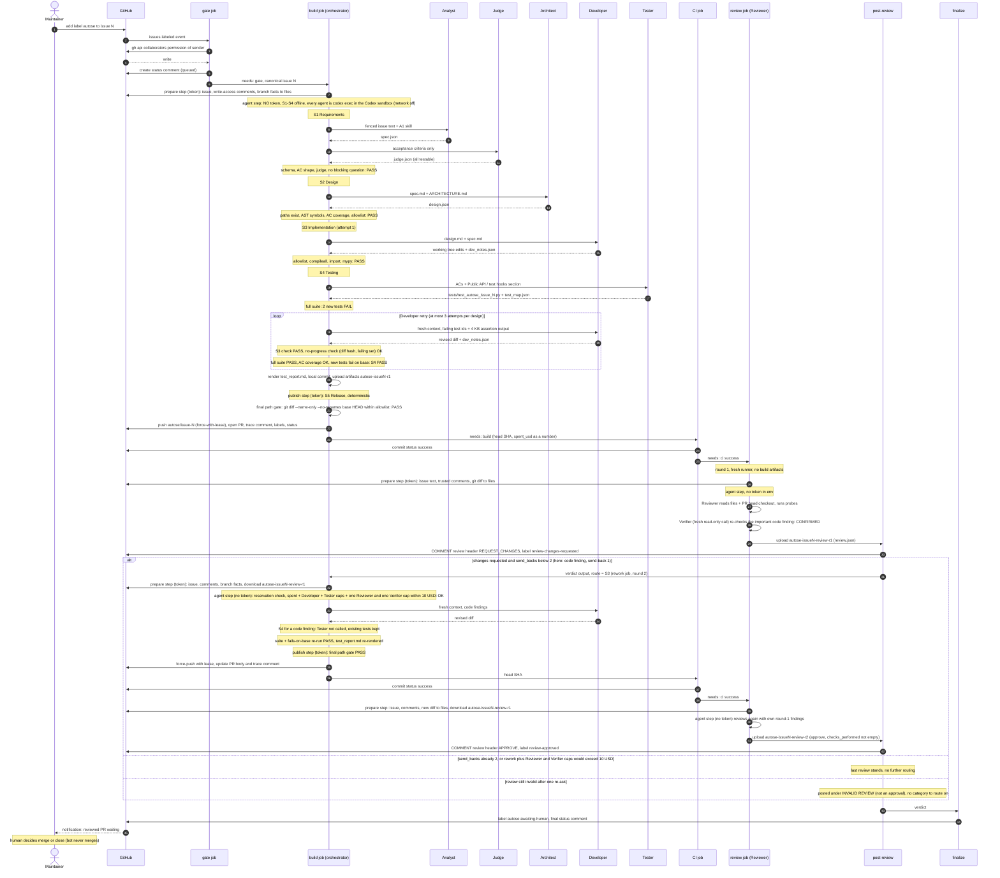

# Sequence view

> **PLANNED sequence (pre-implementation). Will be replaced by the sequence of a real run with run/PR links once runs exist.**

Source of truth: [`../DESIGN.md`](../DESIGN.md) (sections 2, 2.1, 3, 4, 5, 6). Rendered copies: `sequence-view.svg` / `.png` (source `sequence-view.mmd`).

This shows one full-pipeline run triggered by the label `autose`, including one test-failure retry inside S3/S4 and one review send-back (a `code` finding, routed to S3), so that both loop levels are visible: the in-job loop run by the orchestrator, and the cross-job loop run through the `autose-round.yml` rounds. The `build job (orchestrator)` lifeline also stands for the round-2 `rework` job, which runs the same orchestrator code.

Notes on the planned run (routes follow DESIGN.md section 2.1):

- Steps 3-5: the gate checks the sender through the collaborators API and creates the sticky status comment. Later steps edit it in place.
- Step 7: the build job's *prepare* step (token) writes the issue, trusted comments and branch facts to files. The *agent* step that follows has **no GitHub token**: the orchestrator runs S1-S4 offline and ends with a local commit. Every agent runs as `codex exec` in the Codex sandbox with network off and no repo instructions or MCP loaded (ADR-014).
- Steps 8-11: the Analyst sees the fenced issue (from the prepare step's files); the Judge sees only the AC list. The orchestrator, not an agent, decides the S1 check.
- Developer retry loop: a suite failure goes back to S3 and uses one of the 3 Developer attempts for this design. Every attempt starts from a fresh context and receives only the failing test ids plus assertion output truncated to 4 KB. If the diff hash or the failing test set repeats, the orchestrator treats the attempts as exhausted and goes to the design revisit (if unused) or stops.
- `test_report.md` is rendered by the orchestrator, not written by the Tester.
- S5 Release is deterministic and runs in the *publish* step (token): the final path gate `git diff --name-only --no-renames <base> HEAD` must stay within the allowlist before anything is pushed, then push with lease, PR, trace comment, labels and status. No agent pushes or opens the PR. The build job passes its spend to the round as a plain number (`spent_usd`). A failing push/PR call is retried once after 10 s; a CI failure stops the run with the CI log linked in `pr.md`.
- Review job: fresh runner with read-only permissions. A prepare step (with the token) writes the issue text, trusted comments and `git diff base...head` to files; the agent step has no token and reads only those files, the PR head checkout and, from round 2, its own previous `review.json` (`autose-issueN-review-r1`). It never downloads the build artifacts. After a valid review, each `important` finding is re-checked by a separate read-only Verifier call that sees only that finding, the issue, the diff and the code (ADR-015); a `REJECTED` finding is shown under "Dropped by verification" and does not route. It re-asks an invalid review only if `spent_usd` plus one Reviewer cap fits the $10 run cap; post-review discards a review whose SHA is no longer the PR head.
- Send-back: post-review emits `verdict` and the route (only `important` findings that survived verification route). The round-2 `rework` job has the same prepare / agent (no token) / publish split; its prepare step downloads the review that routed it, and its agent step first checks the reservation rule (the rework only starts if one Reviewer cap plus one Verifier cap still fits under the run cap after it, otherwise the last review stands). For a `code` finding it re-enters at S3; S4 keeps the existing tests and only re-runs the suite and the fails-on-base check (an `approach` finding would instead go to S2 and the Tester would regenerate its tests; a `tests` finding would go to S4). Then S5, CI and review run again. After 2 send-backs the next review is final.
- The verdict is posted as a `COMMENT` review (a `GITHUB_TOKEN`-opened PR cannot be approved by the same identity) with the verdict in its header and a verdict label. A review that is still invalid after one re-ask is posted under "INVALID REVIEW (not an approval)" and the run ends `awaiting-human`. The bot never merges.

## Real run (to be filled)

Run: _Actions run link_ · Issue: _link_ · PR: _link_ · Review: _link_

| step | timestamp | job | artifact | link |
|---|---|---|---|---|
| 1 | | gate | status comment | |
| 2 | | build | `spec.md`, `spec.json`, `judge.json` | |
| 3 | | build | `design.md`, `design.json` | |
| 4 | | build | `diff.patch`, `dev_notes.json` | |
| 5 | | build | `tests/test_autose_issue_<N>.py`, `test_map.json`, `test_report.md` (orchestrator-rendered) | |
| 6 | | build | `pr.md`, PR link, trace comment | |
| 7 | | ci | commit status | |
| 8 | | review | `review.json` (`autose-issueN-review-r1`) | |
| 9 | | post-review | `review.md` (PR review) | |
| ... | | rework / ci / review / post-review | | |
| n | | finalize | final label + status comment | |
