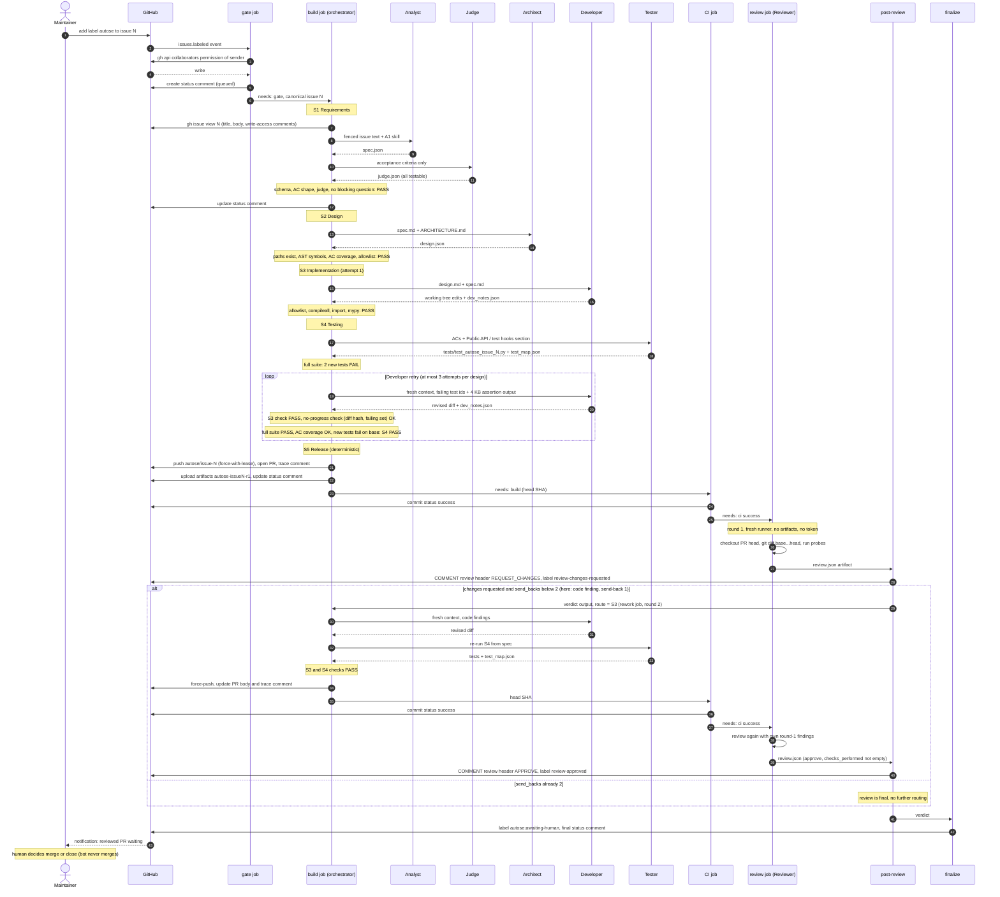

# Sequence view

> **PLANNED sequence (pre-implementation). Will be replaced by the sequence of a real run with run/PR links once runs exist.**

Source of truth: [`../DESIGN.md`](../DESIGN.md) (sections 2, 3, 4, 5). Rendered copies: `sequence-view.svg` / `.png` (source `sequence-view.mmd`).

This shows one full-pipeline run triggered by the label `autose`, including one test-failure retry inside S3/S4 and one review send-back (a `code` finding, routed to S3), so that both loop levels are visible: the in-job loop run by the orchestrator, and the cross-job loop run through the `autose-round.yml` rounds. The `build job (orchestrator)` lifeline also stands for the round-2 `rework` job, which runs the same orchestrator code.

Notes on the planned run:

- Steps 3-5: the gate checks the sender through the collaborators API and creates the sticky status comment. Later steps edit it in place.
- Steps 8-11: the Analyst sees the fenced issue; the Judge sees only the AC list. The orchestrator, not an agent, decides the S1 check.
- Developer retry loop: every attempt starts from a fresh context and receives only the failing test ids plus assertion output truncated to 4 KB. The no-progress detector compares the diff hash and failing test set with the previous attempt.
- S5 Release is deterministic: no agent pushes or opens the PR.
- Review job: fresh runner, `contents: read`, no token in the agent environment, no build artifacts. It sees the raw issue, `git diff base...head`, the PR head checkout and (in round 2) its own round-1 findings.
- Send-back: post-review emits `verdict` and the route; the round-2 `rework` job re-enters at S3 and re-runs every later stage up to S5, then CI and review run again. After 2 send-backs the next review is final.
- The verdict is posted as a `COMMENT` review (a `GITHUB_TOKEN`-opened PR cannot be approved by the same identity) with the verdict in its header and a verdict label. The bot never merges.

## Real run (to be filled)

Run: _Actions run link_ · Issue: _link_ · PR: _link_ · Review: _link_

| step | timestamp | job | artifact | link |
|---|---|---|---|---|
| 1 | | gate | status comment | |
| 2 | | build | `spec.md`, `spec.json`, `judge.json` | |
| 3 | | build | `design.md`, `design.json` | |
| 4 | | build | `diff.patch`, `dev_notes.json` | |
| 5 | | build | `tests/test_autose_issue_<N>.py`, `test_map.json`, `test_report.md` | |
| 6 | | build | `pr.md`, PR link, trace comment | |
| 7 | | ci | commit status | |
| 8 | | review | `review.json` | |
| 9 | | post-review | `review.md` (PR review) | |
| ... | | rework / ci / review / post-review | | |
| n | | finalize | final label + status comment | |
