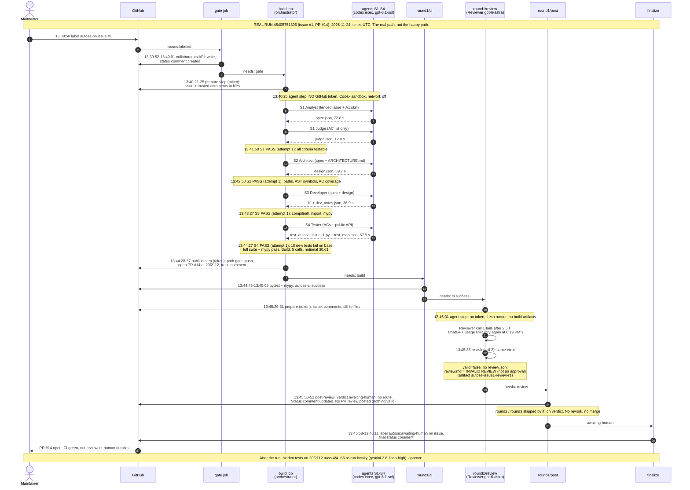

# Sequence view (one real run)

This is the sequence of a **real** GitHub Actions run, not a planned one: issue [#1](https://github.com/vishesh312/tinydb/issues/1) labelled `autose` on 2026-11-24, Actions run [45405751306](https://github.com/vishesh312/tinydb/actions/runs/45405751306), PR [#14](https://github.com/vishesh312/tinydb/pull/14). It shows the path the run actually took, which is **not** the happy path: stages S1-S5 passed on their first attempt, but the Reviewer could not run because the shared ChatGPT subscription had hit its usage limit (about 13:45 UTC, while four other CI runs and the local E1/E2 experiments were using the same account). The fail-safe of ADR-013 worked: the review was marked invalid, nothing was routed or merged, and the run ended `awaiting-human`.

Sources for every timestamp: the job and step times of the Actions run (`gh run view 45405751306 --json jobs`), the build ledger [`results/ledgers/45405751306-autose-issue1-build.jsonl`](../../results/ledgers/45405751306-autose-issue1-build.jsonl) (agent durations, check results, notional cost), the review ledger [`results/ledgers/45405751306-autose-issue1-review-r1.jsonl`](../../results/ledgers/45405751306-autose-issue1-review-r1.jsonl) and the status comment on issue #1. Ledger `ts` values are the **end** time of each call. Rendered copies: `sequence-view.svg` / `.png` (source `sequence-view.mmd`, rendered with `@mermaid-js/mermaid-cli@11.4.2`). The five agents of S1-S4 are drawn as one lifeline to keep the diagram readable; each arrow is a separate `codex exec` process with its own prompt, sandbox and schema.

## Step table with links

| step | time (UTC) | job | what happened | artifact / link |
|---|---|---|---|---|
| 1-3 | 13:39:50-13:40:01 | gate | label event; sender checked via the collaborators API (write); sticky status comment created 13:39:58 | [gate job](https://github.com/vishesh312/tinydb/actions/runs/45405751306/job/138485913390), [status comment](https://github.com/vishesh312/tinydb/issues/1#issuecomment-7133158314) |
| 5 | 13:40:21-13:40:25 | build: prepare (token) | issue text, trusted comments and branch facts written to files | [build job](https://github.com/vishesh312/tinydb/actions/runs/45405751306/job/138486020120) |
| 6-9 | ends 13:41:38 / 13:41:50 | build: agent step (no token) | S1 Analyst (72.8 s) and Judge (12.0 s); check "all criteria testable" | `spec.md`, `spec.json`, `judge.json` (build artifact) |
| 10-11 | ends 13:42:50 | build: agent step | S2 Architect (59.7 s); "design checks passed" | `design.md`, `design.json` |
| 12-13 | ends 13:43:27 | build: agent step | S3 Developer (36.9 s); "compileall, import and mypy passed" | `diff.patch`, `dev_notes.json` |
| 14-15 | ends 13:44:25, suite 13:44:27 | build: agent step | S4 Tester (57.9 s); "AC mapping complete; 10 new test(s) fail on base"; "full suite and mypy passed" | `tests/test_autose_issue_1.py`, `test_map.json`, `test_report.md` |
| 16 | 13:44:28-13:44:37 | build: publish (token) | final path gate, push `autose/issue-1`, PR #14 opened at `20f2112`, trace comment | [PR #14](https://github.com/vishesh312/tinydb/pull/14), [trace comment](https://github.com/vishesh312/tinydb/pull/14#issuecomment-7133269846) |
| 18 | 13:44:45-13:45:05 | round1 / ci | pytest + mypy on the PR head; commit status `autose-ci` = success | [ci job](https://github.com/vishesh312/tinydb/actions/runs/45405751306/job/138488884348) |
| 20-22 | 13:45:07-13:45:41 | round1 / review | prepare (token) 13:45:29-31; agent step (no token) 13:45:31-36: Reviewer call failed after 2.5 s with the ChatGPT usage limit, re-ask at 13:45:36 failed the same way | [review job](https://github.com/vishesh312/tinydb/actions/runs/45405751306/job/138489109017); artifact `autose-issue1-review-r1` (`review_meta.json` valid=false, `review.md` headed "INVALID REVIEW (not an approval)") |
| 24 | 13:45:43-13:45:55 | round1 / post | `verdict=awaiting-human`, empty route; status comment updated. **No PR review was posted**, because there was no `review.json` to render | [post job](https://github.com/vishesh312/tinydb/actions/runs/45405751306/job/138489487868) |
| - | 13:45:56 | round2, round3 | skipped by their `if:` on the round-1 verdict | |
| 26 | 13:45:58-13:46:11 | finalize | label `autose:awaiting-human` on issue #1, final status line | [finalize job](https://github.com/vishesh312/tinydb/actions/runs/45405751306/job/138489630518) |

Totals for the run: 5 ledgered agent calls in the build (153,103 input, 10,103 output, 317,952 cached input tokens; notional $0.61), 2 failed reviewer calls with no usage reported, wall time 6 min 21 s (13:39:50-13:46:11).

## What this run shows, and what it does not

- **Shown:** the gate, the prepare / tokenless-agent / publish split, all S1-S5 checks, CI as a reusable job, the review job on a fresh runner without build artifacts, the re-ask of an invalid review, and the fail-safe end state (`awaiting-human`, no merge, no routing on an invalid review).
- **Not shown by any real GitHub run:** a valid review, the Verifier pass (ADR-015), and the cross-job send-back loop (`round2` rework). The S6 review of this PR's diff was re-run locally after the quota reset (`results/real-pr-reviews/PR-issue1-independent/`, gemini-3.8-flash-high via `agy`): approve, consistent with the hidden tests (4/4 on `20f2112`). The send-back routing is covered only by the offline orchestrator tests and the state-machine view.
- **A gap this run exposed:** the design says an invalid review is "posted under INVALID REVIEW (not an approval)". When the reviewer produces no `review.json` at all (as here), `post-review` posts nothing on the PR; the invalid verdict is visible only in the issue's status comment, the issue label and the review artifact. A maintainer looking only at PR #14 sees an open PR with green CI and no review.
- **A second wart:** the seeded-PR review run for PR #7 ([45406746710](https://github.com/vishesh312/tinydb/actions/runs/45406746710)) carries issue number 1 in its `label.json`, so it appended its own (also quota-failed) lines to issue #1's status comment at 13:47-13:48.
