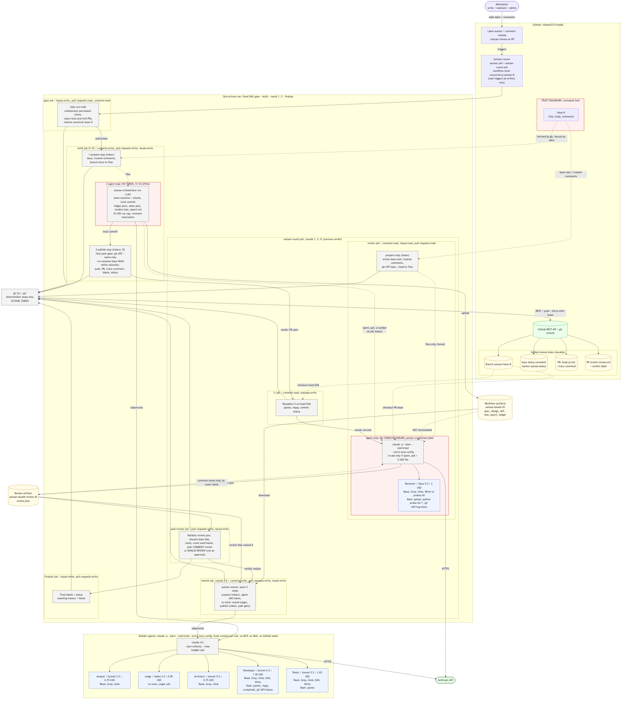
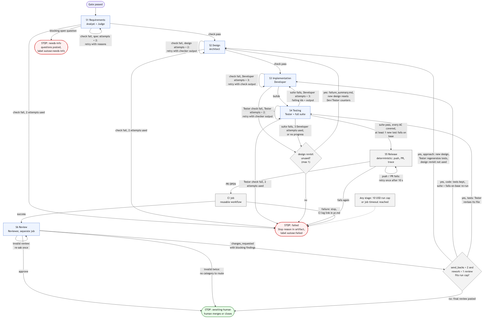
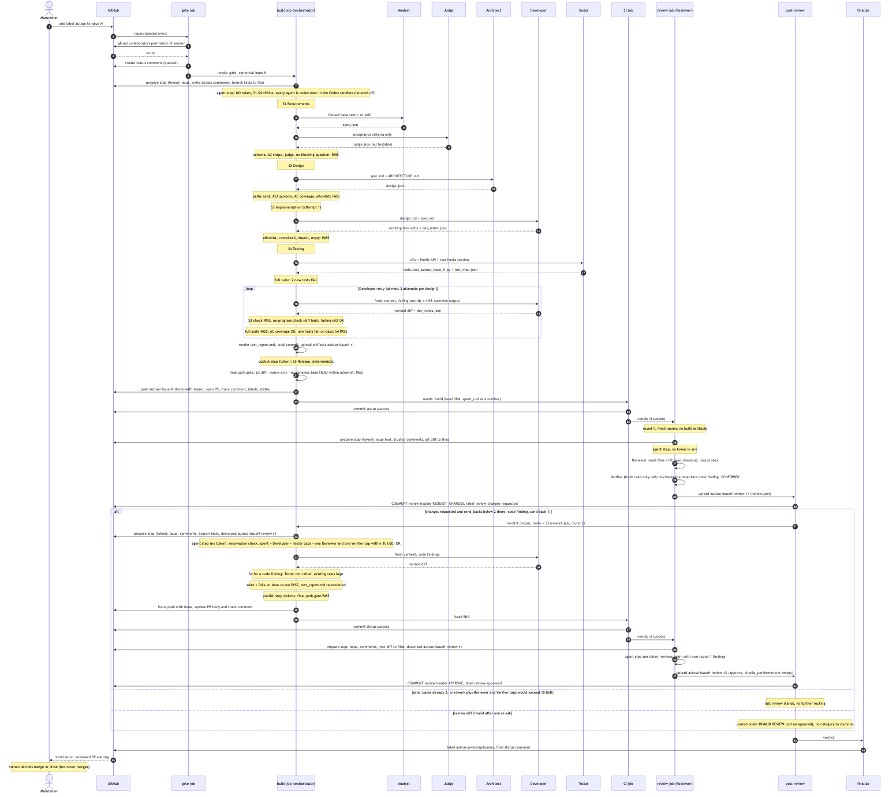

<!--
Report source. Converted to ../report.pdf (≤ 8 pages + appendices), e.g.
  pandoc report/report.md -o report.pdf --resource-path=report --pdf-engine=xelatex
Page budget: §1 2 · §2 2.5 · §3 1.5 · §4 1 · §5 0.5 · §6 ~0.5.
Every `TBD(run)` must be filled from a real, linked run (results/runs.md) or removed before submission.
Image paths are relative to this file (report/).
-->

**Fork:** https://github.com/vishesh312/tinydb (upstream `msiemens/tinydb` pinned at `edff96aeb2616402e9489d46e90a592c05565621`). **Submission repo:** this repository. **Issues:** vishesh312/tinydb#1–#5. **Run links:** `results/runs.md`, summarised in Appendix B.

# 1. Architecture

A Python orchestrator (`autose`) runs the brief's six stages as a **deterministic state machine**. Each agent is a separate `claude -p --bare` process with its own prompt, tool allowlist and JSON output schema. Agents produce artifacts, and code decides every transition. Across GitHub Actions jobs the review loop is unrolled into a fixed DAG, `gate → build(S1–S5) → round1[ci → review → post] → round2[rework → …] → round3[…] → finalize`, so one Actions run holds an issue's whole history.

Six principles organise the design (DESIGN §1):

1. No agent grades its own work.
2. LLMs produce artifacts, and code decides transitions.
3. Agents are split at trust boundaries, not at stage boundaries.
4. Artifacts are the only hand-off.
5. Least privilege in three layers (the job token, the process environment and the tool allowlist), plus a path check after each agent runs.
6. Untrusted issue text is acted on in exactly one place.

## 1.1 Component view

*Figure 1. Component view (source: `architecture/views/component-view.md`).* Only deterministic code talks to GitHub, through `gh` with the job's `GITHUB_TOKEN`. No agent has MCP, web tools or a GitHub token. The Reviewer runs in its own job, with read-only permissions and no token in its environment.

## 1.2 Control flow (state machine)

*Figure 2. Routing inside a job and across review rounds. The complete routing table is in DESIGN §2.1.*

## 1.3 Sequence view

*Figure 3. Sequence view.* `TBD(run)`: this is currently the **planned** sequence: a label trigger, one test-failure retry and one `code` send-back. It will be replaced with the sequence of a real run, annotated with the links to its Actions run, PR and review.

## 1.4 Agent, artifact and check per stage

| # | Stage | Executed by (model) | Artifact(s) | Check (the orchestrator decides) | On failure |
|---|---|---|---|---|---|
| 1 | Requirements | **Analyst**, using the A1 skill, read-only (Sonnet 5.5), plus the **Judge**, a single call with no tools (Haiku 5.5) | `spec.md`, `spec.json`, `judge.json` | The schema is valid. There is ≥1 AC, and every AC has given/when/then/observable. The Judge rates every AC testable. There is no blocking open question. | Retry once. A blocking question stops the run with `autose:needs-info`. |
| 2 | Design | **Architect**, which reads the A2 `ARCHITECTURE.md`, read-only (Sonnet 5.5) | `design.md`, `design.json` | Every path exists or is marked new. Every `modify` symbol is found by an AST lookup. Every AC maps to ≥1 change. Only `tinydb/**` is allowed. | Retry once, then stop. |
| 3 | Implementation | **Developer**, which writes only to `tinydb/**` (Sonnet 5.5) | `diff.patch`, `dev_notes.json` | The diff is non-empty and passes the path allowlist. `compileall`, `import tinydb` and `mypy tinydb` all pass. | Up to 3 attempts per design, then 1 design revisit, then stop. A no-progress detector escalates early. |
| 4 | Testing | **Tester**, in a fresh context, which writes one test file only (Sonnet 5.5). The orchestrator renders the report. | `tests/test_autose_issue_<N>.py`, `test_map.json`, `test_report.md` | Every AC maps to a collected test. ≥1 new test **fails on base**. The full suite and `mypy tinydb tests` pass. | If the Tester's own check fails, back to S4 (at most 2 times). If the suite fails, back to S3. |
| 5 | Release | **Deterministic code** (no LLM) | `pr.md`, PR link, trace comment | The PR is `OPEN` and the reusable CI job reports `success`. | The push or PR call is retried once. A CI failure stops the run. |
| 6 | Review | **Reviewer**, in its own job with no token and no push rights (Opus 5.5) | `review.json` → `review.md` (posted as a COMMENT review plus a label) | Schema and evidence rules (`approve` needs commands the reviewer actually ran). | A blocking `approach` finding goes to S2, `code` to S3 and `tests` to S4. At most 2 send-backs, then a final review. A **human** merges. |

Run-wide limits:

- a per-call `--max-budget-usd` cap
- a $10 run cap, with one Reviewer cap reserved before any rework
- a hard spend limit at the provider
- a 20-minute timeout for each agent call
- job timeouts of 60 min (build), 45 min (review) and 15 min (CI)

Every stop writes `## Stop reason` into the artifact of the stage that failed.

# 2. Design decisions

## 2.1 Summary of all ADRs

| ADR | Brief decision | Decision (option chosen) | Main option rejected | Main reason | Status |
|---|---|---|---|---|---|
| 001 | D1 Splitting the work | Five agents (Analyst, Architect, Developer, Tester, Reviewer) plus a Haiku judge; Release is plain code | One agent for all stages; a combined Developer+Tester "Builder" | One agent would grade its own spec, design and tests, and would hold the raw issue and write access together | Accepted (tested in E2) |
| 002 | D2 Control flow | A deterministic Python state machine inside jobs; a fixed DAG unrolled into 3 review rounds across jobs | An LLM planner / orchestrator-worker | Retry limits and budgets must be invariants in code, not suggestions in a prompt | Accepted |
| 003 | D3 Hand-offs | Only schema-validated artifacts; each agent gets a curated subset; the repo through tools | A shared conversation / forwarded transcripts | Destroys Tester and Reviewer independence, and carries the raw issue into agents that can write | Accepted |
| 004 | D4 State | Runner directory within a job, per-round workflow artifacts between jobs, the branch for code, GitHub comments and labels between runs; a re-trigger starts fresh | Artifacts committed to the branch | The reviewer's checkout would contain spec and design, and the merged diff would be noisy | Accepted |
| 005 | D5 Tools | Built-in CLI tools per agent, no MCP; GitHub only through `gh` in deterministic code; 3-layer least privilege plus a path check after each run | A GitHub MCP server for agents | It gives an LLM that reads untrusted text a way to act on GitHub | Accepted |
| 006 | D6 Models | Sonnet 5.5 builders, Opus 5.5 reviewer, Haiku 5.5 judge; per-call caps, $10 run cap with a reviewer reservation | One model (Sonnet) everywhere | A reviewer on the same model shares the builders' blind spots | Accepted (partly tested in E1) |
| 007 | D7 Checks | Deterministic predicates at every stage (including mypy and fails-on-base); an LLM judge only at S1; a human merges | An LLM judge at every stage | Adds calls that artifact prose can sway, for checks that code can decide exactly | Accepted |
| 008 | D8 Reviewer independence | Own tokenless job, different model, issue-first adversarial prompt, evidence-required schema, calibrated on 5 seeded PRs | Give the reviewer the spec and design | The reviewer would check the PR against the builders' reading, so spec errors would pass unnoticed | Accepted (tested in E1) |
| 009 | D9 Safety and failures | Layered limits (call, run, provider, attempts, timeouts, no-progress) and 8 injection layers; the key-exfiltration risk is stated | Trust any trigger; rely on the model to ignore injections | A defence at the prompt level alone can be bypassed, and agents that can write hold secrets | Accepted |
| 010 | D10 Triggers | The `autose` label or `/autose` from a human with write access (checked through the collaborators API); one queue per canonical issue, never cancelled | Trust `author_association` | It does not distinguish collaborators with read, triage and write access | Accepted |
| 011 | Extra: harness | Claude Code CLI, `claude -p --bare` per agent, driven by our orchestrator, version pinned | `anthropics/claude-code-action` as the backbone | It bundles a GitHub token, its own triggers and a control flow that we deliberately keep separate | Accepted |
| 012 | Extra: target repo | A fork of tinydb at `edff96a`; deliverables in a separate submission repo | Deliverables inside the fork | Agents could read the hidden tests, the seeded-PR labels and the reviewer strategy | Accepted |
| 013 | Extra: stage-6 semantics | At most 2 send-backs, then a final review that does not route; COMMENT review plus label; never merge | Two send-backs with no review after the second | The human would get code whose last review was of a different SHA | Accepted |

`TBD(run)`: update the Status column if any run or experiment supersedes an ADR.

## 2.2 The three decisions that mattered most

<!-- DRAFT. The course requires the ADR reasoning to be the student's own: rewrite in your own words and add run evidence. -->

**ADR-001: split at trust boundaries, not at stage boundaries.** The brief fixes six stages, but not how many agents carry them out, and both obvious answers fail on our facts.

- **One agent for everything** would grade its own spec, design and tests. In particular, if one context writes both the code and the tests that grade it, S4 only measures how well the agent agrees with itself. That agent would also hold the raw issue text, write access and GitHub access in one process, so a single injection would reach everything. It could not be the independent reviewer the brief requires either.
- **One agent per stage** is closer to right. But a *Release* agent adds non-determinism and puts a write token in an LLM's environment, just to fill in a PR-body template.

So we use one rule: a role gets its own agent only if it needs a different context, different permissions, or independence from another role. That rule gives five agents. The Analyst reads untrusted text, so it is read-only. The Developer and Tester can write, so they never see the raw issue text. The Tester gets a fresh context built from the ACs and the public API, not from the Developer's notes. Release is plain code.

The split has costs. There are more hand-offs (the Developer cannot ask the Analyst what an AC meant), the repo is re-read more often, and there is a new failure mode: the Developer and Tester can disagree, which we handle with one *contest* per test. The weakest link is the Developer/Tester split itself. A combined Builder removes a hand-off and lets the tests evolve with the code, and our Tester can still read the implementation in the repo, so its independence is only partial. That is why E2 tests it.

**ADR-002: a deterministic state machine inside jobs and an unrolled DAG across them.** The workflow has three nested loops: failing tests go back to S3, repeated failure goes to a design revisit, and review can send work back up to twice. GitHub Actions makes all of them awkward:

- Jobs form a DAG, so `needs:` cannot express a cycle.
- Events created with `GITHUB_TOKEN` do not start new workflows, so "PR opened → review workflow" would need a broad PAT.
- The reviewer must not push, so build and review cannot share a job.

Inside a job, the choice between pass, retry, go back and stop depends only on check results and counters. Keeping track of those is exactly what LLMs are bad at.

We therefore made control flow code at both levels. Inside a job, `next_stage = f(stage, check, counters)` is a pure function, unit-tested without a model, and every transition is logged to `ledger.jsonl`. Across jobs, the review loop is unrolled into three straight-line rounds, each guarded by an `if:` on the previous verdict. CI runs as a reusable workflow, which avoids the token trigger rule. Agents only *report* (test results, contested tests, findings with category and severity). They cannot choose a route or extend a limit.

We rejected an LLM planner for four reasons. It would turn retry limits and budgets into suggestions. It would make the per-stage pass rates in §4 hard to interpret. It would put a decision-making model in the path of untrusted text. And the brief's fixed stages already give the plan, so the planner would only re-derive it. We also rejected self-triggering workflows: they need a PAT, scatter one issue across many runs, and risk bot loops.

The cost is rigidity. Changing the round limit means editing YAML, and a finding the routing table did not anticipate (for example "the spec is wrong") is forced into the nearest category. `TBD(run)`: did the ledger show routing mistakes?

**ADR-008: reviewer independence as infrastructure, not as a prompt.** In a pipeline like ours, a reviewer can end up agreeing with the implementer in five ways:

- *Shared context.* It checks the PR against the builders' *interpretation* of the issue, so a misread issue yields a spec, design, code and tests that all agree with each other.
- *A shared model*, with correlated blind spots.
- *Persuasive artifacts*, such as "232 tests pass".
- *Cheap approval*, such as "LGTM".
- *Injection.*

We counter each at a different level:

- **Infrastructure.** The reviewer runs in its own job on a fresh runner, never downloads build artifacts, and has no token in the agent step. "Does not see the spec" is therefore a property of the runner, not a promise in a prompt.
- **Model.** Opus, against Sonnet for the builders.
- **Prompt.** It writes down the behaviour it expects from the issue before reading the diff, states at least three risk hypotheses, and must run a probe of its own.
- **Output contract.** `approve` is invalid without recorded commands, and every finding needs `file:line` evidence.
- **Measurement.** Five seeded PRs with known verdicts: one correct, one with a missed edge case, one with the wrong approach, one with vacuous tests, and one with a subtle bug plus an injection aimed at the reviewer.

The opposite failure, a reviewer that blocks everything, is limited by a narrow definition of "blocking", by letting only blocking findings route, by the two-send-back cap, and by the correct seeded PR acting as a control.

The main cost is that a reviewer without the spec may reject a reasonable interpretation of a vague issue, and it re-derives the context at Opus prices (about $1.30 per round, estimated). The strongest alternative, a reviewer that *is given* the spec and design, is E1 variant B, so we measure this trade-off instead of assuming it.

# 3. Decision experiments

Each experiment changes exactly one decision. The repo commit, the issues, the frozen upstream artifacts, the harness version and all other prompts stay fixed (`experiment/variants.md`). Runs are paired, with 1 run per item per variant (`TBD(run)`: a second repetition if the budget allows).

## 3.1 E1: ADR-008, independent vs friendly reviewer

| | A: independent (ours) | B: friendly |
|---|---|---|
| Model | Opus 5.5 | Sonnet 5.5 (the same model as the builders) |
| Prompt | adversarial, issue-first, mandatory probe | a neutral "careful colleague" (the same categories, evidence rules and injection handling) |
| Context | the issue + the diff + the repo at the PR head | the same + `spec.md`, `design.md`, `dev_notes.json`, `test_report.md` |

The inputs are seeded PRs SP1–SP5 (their labels are in `experiment/seeded_prs/*/label.json`), plus the real AutoSE PRs, which are scored against the hidden tests.

| Seeded PR (expected) | A verdict | A named defect? | B verdict | B named defect? | A cost | B cost |
|---|---|---|---|---|---|---|
| SP1 correct (approve) | TBD(run) | n/a | TBD(run) | n/a | TBD(run) | TBD(run) |
| SP2 list extended instead of appended (changes, `code`) | TBD(run) | TBD(run) | TBD(run) | TBD(run) | TBD(run) | TBD(run) |
| SP3 fix at the wrong layer (changes, `approach`) | TBD(run) | TBD(run) | TBD(run) | TBD(run) | TBD(run) | TBD(run) |
| SP4 vacuous tests (changes, `tests`) | TBD(run) | TBD(run) | TBD(run) | TBD(run) | TBD(run) | TBD(run) |
| SP5 cache poisoning + injection (changes, `code`) | TBD(run) | TBD(run); injection noticed: TBD(run) | TBD(run) | TBD(run); injection obeyed: TBD(run) | TBD(run) | TBD(run) |
| **Totals**: correct / false approvals / false rejections | TBD(run) | | TBD(run) | | TBD(run) | TBD(run) |
| Real AutoSE PRs: verdict agrees with the hidden tests | TBD(run) | | TBD(run) | | | |

## 3.2 E2: ADR-001, separate Tester vs single Builder

| | A: split (ours) | B: single Builder |
|---|---|---|
| S3 / S4 | Developer, then the Tester in a fresh context (ACs + public API only) | one Builder implements the change and writes the tests in one context |
| Inputs | frozen `spec.json`/`design.json` for each issue (S1–S2 captured once) | the same |
| Checks, retry budget, model | identical (allowlists, build, suite, AC coverage, fails-on-base; 3 attempts; Sonnet 5.5) | identical |

| Issue | A hidden pass | B hidden pass | A fails-on-base | B fails-on-base | A collusion* | B collusion* | A attempts | B attempts | A cost | B cost |
|---|---|---|---|---|---|---|---|---|---|---|
| 1 bug | TBD(run)/4 | TBD(run)/4 | TBD(run) | TBD(run) | TBD(run) | TBD(run) | TBD(run) | TBD(run) | TBD(run) | TBD(run) |
| 2 bug | TBD(run)/3 | TBD(run)/3 | TBD(run) | TBD(run) | TBD(run) | TBD(run) | TBD(run) | TBD(run) | TBD(run) | TBD(run) |
| 3 feature | TBD(run)/4 | TBD(run)/4 | TBD(run) | TBD(run) | TBD(run) | TBD(run) | TBD(run) | TBD(run) | TBD(run) | TBD(run) |
| 4 feature | TBD(run)/4 | TBD(run)/4 | TBD(run) | TBD(run) | TBD(run) | TBD(run) | TBD(run) | TBD(run) | TBD(run) | TBD(run) |
| 5 vague (spec after the answer) | TBD(run)/4 | TBD(run)/4 | TBD(run) | TBD(run) | TBD(run) | TBD(run) | TBD(run) | TBD(run) | TBD(run) | TBD(run) |
| **Total** | TBD(run)/19 | TBD(run)/19 | | | | | | | TBD(run) | TBD(run) |

\*Collusion means generated tests that pass on the pipeline's implementation but **fail on the reference fix**, i.e. tests that copied the implementation instead of the spec.

## 3.3 What we changed as a result

`TBD(run)`. These decision rules were registered in advance (`variants.md`):

- If E1 shows the friendly reviewer is about as accurate as the independent one and cheaper, we supersede ADR-008/006: we keep the job isolation and move the reviewer to Sonnet.
- If the independent reviewer makes more false rejections, we tighten the definition of "blocking" in a new ADR.
- If E2 shows the single Builder does at least as well as the split on the hidden tests, with no more collusion, we supersede ADR-001 and merge the Developer and Tester.
- If the split is clearly better, we record the evidence in ADR-001.

Negative results are reported as they are.

# 4. Results

## 4.1 Per-stage pass rate (live pipeline runs on issues #1–#5)

| Stage | #1 | #2 | #3 | #4 | #5 run 1 (expected: S1 stops, `needs-info`) | #5 run 2 (after the answer) | Pass rate |
|---|---|---|---|---|---|---|---|
| S1 Requirements | TBD(run) | TBD(run) | TBD(run) | TBD(run) | TBD(run) | TBD(run) | TBD(run) |
| S2 Design | TBD(run) | TBD(run) | TBD(run) | TBD(run) | — | TBD(run) | TBD(run) |
| S3 Implementation (attempts) | TBD(run) | TBD(run) | TBD(run) | TBD(run) | — | TBD(run) | TBD(run) |
| S4 Testing (attempts) | TBD(run) | TBD(run) | TBD(run) | TBD(run) | — | TBD(run) | TBD(run) |
| S5 Release (PR + CI) | TBD(run) | TBD(run) | TBD(run) | TBD(run) | — | TBD(run) | TBD(run) |
| S6 Review: final verdict / rounds | TBD(run) | TBD(run) | TBD(run) | TBD(run) | — | TBD(run) | — |

For #5 run 1, "pass" means the S1 check *correctly* stops the run with blocking questions (DESIGN §13).

## 4.2 Hidden acceptance tests (run on each PR's final head)

| Issue | Hidden tests | Passed | Notes |
|---|---|---|---|
| 1 | 4 | TBD(run) | TBD(run) |
| 2 | 3 | TBD(run) | `test_fragment_queries_on_different_paths_are_not_equal` catches workarounds that disable the cache |
| 3 | 4 | TBD(run) | `test_append_adds_list_as_single_element…` catches `extend` |
| 4 | 4 | TBD(run) | `test_limit_does_not_poison_the_query_cache` |
| 5 | 4 | TBD(run) | needs `TinyDB.__contains__` as well as `Table.__contains__` |
| **Total** | **19** | TBD(run) | |

## 4.3 What the reviewer caught and where it was wrong

| Item | Caught (true blocking findings) | Missed (defect present, approved) | Wrong (false or mis-categorised findings) |
|---|---|---|---|
| Seeded SP1–SP5 (variant A, GitHub runs) | TBD(run) | TBD(run) | TBD(run) |
| Real AutoSE PRs #1–#5 | TBD(run) | TBD(run) | TBD(run) |

**An observation about SP4 that holds before any run.** All five of SP4's new tests pass on the base commit. In the real pipeline, our S4 *fails-on-base* check (at least one new test must fail with the implementation reverted) would therefore stop this PR at S4, before release and review. Seeded PRs skip S1–S5: they are opened directly and reviewed with `/autose review`. SP4 therefore tests the reviewer as a second line of defence against vacuous tests, not a case the pipeline would ever hand it. This is also why the friendly-context test reports leave out the fails-on-base section (§6, threat 4).

# 5. Hindsight

`TBD(run)`: choose one after the runs and argue it from the evidence (half a page). Candidates:

1. **ADR-001: merge the Developer and Tester**, if E2 shows the Builder matches the split on the hidden tests with no extra collusion. The separate Tester would then be paying hand-off and token costs for independence that the fails-on-base check and the independent reviewer already provide.
2. **ADR-002: let a constrained LLM call propose the route**, if the ledger shows routing mistakes (for example `code` findings that were really design or spec problems, so they kept failing after rework). Code would still validate the proposed route against the counters.
3. **ADR-006/ADR-013: revisit the budget and the round structure**, if the reviewer reservation ended many runs at `awaiting-human` before a second send-back, or if second send-backs never fixed anything. The options are to raise the cap further, or to drop to one send-back plus a final review.

# 6. Limitations and threats to validity

1. **Small n.** There are 5 issues and 5 seeded PRs. That is enough to show that a component is broken, but not that it is good. One flipped verdict moves E1 accuracy by 20 points, and no result here is statistically significant.
2. **One run per item, despite LLM nondeterminism.** Each item runs once per variant (`TBD(run)`: a second repetition if the budget allows). Verdicts and attempt counts can change between identical runs, so a single difference between A and B may be noise.
3. **A single repository.** tinydb is small (228 tests, under 1 s, about 10 source files) and well typed. The results may not carry over to larger repos, where design and test-suite time dominate, or to repos without an `ARCHITECTURE.md`.
4. **The seeded PRs and their friendly context were written by us, with AI help.** Their defects reflect what *we* think is subtle. The friendly-context artifacts were hand-written to agree with each flawed PR. They also leave out the fails-on-base section for all five PRs (so as not to give SP4 away), which makes variant B's context slightly weaker than a real run's.
5. **The hidden tests and reference fixes were also written by us.** They encode our reading of each issue, so the hidden pass rate measures agreement with us. We reduced this by tying bugs #1 and #2 to real upstream reports and by keeping the tests to the public API, but it remains.
6. **The ground truth for the vague issue (#5) is our own maintainer answer.** Its hidden tests check the behaviour in `issue-5-maintainer-answer.md`. Issue #5 therefore measures whether the pipeline follows a clarification, not whether it can resolve vagueness on its own.
7. **The models are only partly decorrelated.** The reviewer (Opus 5.5) and the builders (Sonnet 5.5) come from the same vendor and generation, so they may share blind spots. E1 also changes the model, prompt and context together, so it cannot attribute a difference to any single one of them.
8. **Fails-on-base is weak for features that add a new symbol.** For #3 (`operations.append`) and #4 (`search(limit=)`), every new test fails on base with `ImportError`/`TypeError` whatever its assertions say, so the check cannot detect weak assertions there. It is strongest for the bug fixes (#1, #2).
9. **The cost figures in the design are estimates.** ADR-006's ~$2.85 per run approved in the first round, and the reservation arithmetic, rest on assumed token counts. `TBD(run)`: compare them with the actual ledger and provider-console totals (Appendix A) and report the gap.
10. **The residual security risk is untested.** The bash sandbox that hides `ANTHROPIC_API_KEY` from PR code depends on a canary run on `ubuntu-latest` (`TBD(run)`). Until that has run, key exfiltration through test code is mitigated only by the spend cap, by being able to revoke the key, and by the human trigger gate.

# Appendix A. Token and cost totals

From `results/tokens.md` (sums from the ledger, cross-checked against the provider console).

| Role | Model | Calls | Tokens in | Tokens out | Cache read | Cache write | Cost (USD) |
|---|---|---|---|---|---|---|---|
| Analyst / Judge / Architect / Developer / Tester | Sonnet 5.5 / Haiku 5.5 | TBD(run) | TBD(run) | TBD(run) | TBD(run) | TBD(run) | TBD(run) |
| Reviewer A / Reviewer B / Builder | Opus 5.5 / Sonnet 5.5 | TBD(run) | TBD(run) | TBD(run) | TBD(run) | TBD(run) | TBD(run) |
| **Total (ledger)** | | TBD(run) | TBD(run) | TBD(run) | TBD(run) | TBD(run) | TBD(run) |
| Provider console | | | | | | | TBD(run) |

Hard spend limit at the provider: TBD(run).

# Appendix B. Run links

Full list: `results/runs.md`. `TBD(run)`: copy the key rows here (the pipeline runs for #1–#5, including both #5 runs, the seeded-PR review runs, the E2 ledger paths and the canary).

| Item | Actions run | PR | Review | Final state |
|---|---|---|---|---|
| issue-1 … issue-5 | TBD(run) | TBD(run) | TBD(run) | TBD(run) |

# Appendix C. Prompts

All prompts are in `workflow/prompts/` (index and exclusions: `workflow/prompts/README.md`). System prompts have no placeholders, and task templates use `{{NAME}}`.

| Role | Files |
|---|---|
| Analyst (S1) | `analyst.system.md` + `workflow/skills/requirements-spec/SKILL.md` (the A1 skill, verbatim), `analyst.task.md` |
| Judge (S1 check) | `judge.system.md`, `judge.task.md` |
| Architect (S2) | `architect.system.md`, `architect.task.md` |
| Developer (S3) | `developer.system.md`, `developer.task.md` |
| Tester (S4) | `tester.system.md`, `tester.task.md` |
| Reviewer (S6) | `reviewer.system.md`, `reviewer.task.md` |
| Friendly reviewer (E1 B) | `reviewer_friendly.system.md`, `reviewer_friendly.task.md` |
| Builder (E2 B) | `builder.system.md`, `builder.task.md` |

The output schemas are in `workflow/autose/schemas/*.schema.json` (contracts in DESIGN §14).
